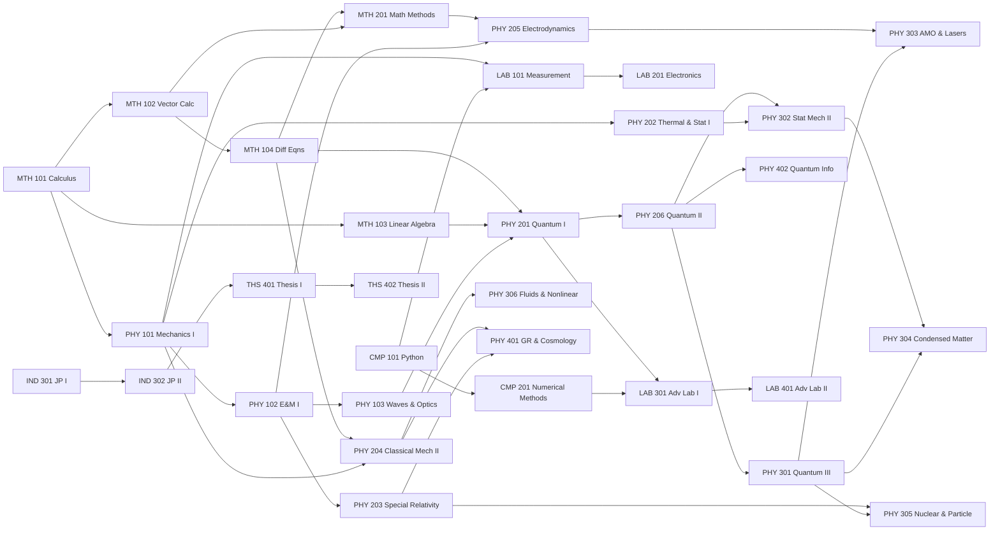

# Curriculum Map

## 1. Design principles

1. **The core is non-negotiable.** Every top programme converges on the same core: mechanics, E&M, waves, quantum (three semesters), thermal and statistical physics, analytical mechanics, electrodynamics, relativity, laboratory work and mathematical methods. That core fills Years 1–3. Its sequence follows MIT's (8.01 → 8.02 → 8.03 → 8.04/8.044 → 8.05 → 8.06) because it is the most carefully prerequisite-chained, and its depth follows Oxford's Parts A and B.
2. **Maths is taught "just in time".** Each maths course lands one semester before the physics that needs it. For example, linear algebra and ODEs come before Quantum I, and PDEs and complex analysis come before Electrodynamics. This follows Oxford's CP3/CP4 and Caltech's ACM 95.
3. **Computing is early and strong** (Harvard Phys 20, MIT 8.006 and 8.16, Caltech Ph 21/22). It is Rimon's comparative advantage as a CSE student, and it makes home "experiments" possible through simulation and open data.
4. **Labs are home-based and use open data.** An MIT Junior Lab can't be replicated at home. What can be done is real measurement with phyphox, Arduino and optics kits, plus analysis of real research data: LIGO, CERN Open Data, SDSS, NIST and others.
5. **Independent work builds up to research.** Junior Papers (Princeton), then the advanced lab project (MIT 8.14), then the Senior Thesis (MIT 8.THU, Princeton, Oxford MPhys).
6. **Year 4 is specialisation**, through two Oxford-style major options plus electives.
7. **Content is drawn from DU where it adds value.** DU's syllabus keeps topics that the US and UK cores often skip: properties of matter, electronics (PH 202/403), lasers and photonics (PH 306), materials and nanotechnology (PH 407), and the annual viva.

## 2. Semester-by-semester plan

Credits: every course is 4 credits.

### Orientation Term 0 (2 Nov – 20 Dec 2026, ungraded)
- **ORI 000 Orientation and Bridging.** Diagnostics in A-level physics and maths. Advanced Standing Exams for MTH 101–104 and CMP 101. Bridging maths. Study skills (Pólya's *How to Solve It*). LaTeX and Git setup. Home-lab kit.

### Year 1: Foundations (Oxford Prelims; MIT GIRs; Harvard 15a/b/c)

| Sem | Code | Title | Prerequisites |
|---|---|---|---|
| S1 | **PHY 101** | Classical Mechanics I | A-level physics; MTH 101 concurrently |
| S1 | **MTH 101** | Calculus for Physicists | A-level maths |
| S1 | **CMP 101** | Computational Physics I: Scientific Python | – |
| S2 | **PHY 102** | Electricity & Magnetism I | PHY 101, MTH 101; MTH 102 concurrently |
| S2 | **MTH 102** | Multivariable & Vector Calculus | MTH 101 |
| S2 | **LAB 101** | Experimental Physics I: Measurement & Uncertainty | PHY 101, CMP 101 |
| S3 | **PHY 103** | Vibrations, Waves & Optics | PHY 102, MTH 102 |
| S3 | **MTH 103** | Linear Algebra | MTH 101 |
| S3 | **MTH 104** | Differential Equations | MTH 102; MTH 103 concurrently |
| S3 W16 | **EXM 100** | **Prelims**: Annual Examination I and viva | All of Year 1 |

### Year 2: Core Physics I (MIT sophomore year; Caltech Ph 12; Oxford Part A)

| Sem | Code | Title | Prerequisites |
|---|---|---|---|
| S4 | **PHY 201** | Quantum Physics I | PHY 103, MTH 103, MTH 104 |
| S4 | **PHY 202** | Thermal & Statistical Physics I | PHY 101, MTH 102; PHY 201 concurrently recommended (as MIT advises for 8.044) |
| S4 | **PHY 203** | Special Relativity | PHY 102, MTH 103 |
| S5 | **PHY 204** | Classical Mechanics II: Lagrangian & Hamiltonian | PHY 101, MTH 104 |
| S5 | **MTH 201** | Mathematical Methods: Complex Analysis, PDEs & Special Functions | MTH 102, MTH 104 |
| S5 | **LAB 201** | Electronics for Physicists | PHY 102, LAB 101 |
| S6 | **PHY 205** | Electrodynamics | PHY 102, PHY 103, MTH 201 |
| S6 | **PHY 206** | Quantum Physics II | PHY 201, MTH 103 |
| S6 | **CMP 201** | Computational Physics II: Numerical Methods | CMP 101, MTH 104 |
| S6 W16 | **EXM 200** | **Part A**: Annual Examination II and viva | Year 2 core |

### Year 3: Core Physics II and Independent Work (Oxford Part B; MIT junior year; Princeton junior year)

| Sem | Code | Title | Prerequisites |
|---|---|---|---|
| S7 | **PHY 301** | Quantum Physics III: Approximation Methods & Applications | PHY 206 |
| S7 | **PHY 302** | Statistical Mechanics II | PHY 202, PHY 206 |
| S7 | **LAB 301** | Advanced Laboratory I (Junior Lab) | PHY 201, LAB 101, CMP 201 |
| S8 | **PHY 303** | Atomic, Molecular & Laser Physics | PHY 301, PHY 205 |
| S8 | **PHY 304** | Condensed Matter Physics | PHY 301, PHY 302 |
| S8 | **IND 301** | Junior Paper I | Year 2 complete |
| S9 | **PHY 305** | Nuclear & Particle Physics | PHY 301, PHY 203 |
| S9 | **PHY 306** | Fluids, Nonlinear Dynamics & Complexity | PHY 204, MTH 201, CMP 201 |
| S9 | **IND 302** | Junior Paper II & Scientific Communication | IND 301 |
| S9 W16 | **EXM 300** | **Part B**: Annual Examination III and viva | Year 3 core |

### Year 4: Specialisation and Research (Oxford Part C / MPhys; MIT thesis; Princeton senior year)

| Sem | Code | Title | Prerequisites |
|---|---|---|---|
| S10 | **PHY 401** | General Relativity & Cosmology | PHY 203, PHY 204, MTH 201 |
| S10 | **PHY 402** | Quantum Information & Computation | PHY 206 |
| S10 | **LAB 401** | Advanced Laboratory II: Experiment Design Project | LAB 301 |
| S11 | **OPT 4x1** | Major Option I (see §5) | Option-specific |
| S11 | **ELE 4xx** | Elective I (see §6) | Elective-specific |
| S11 | **THS 401** | Senior Thesis I | IND 302; thesis proposal approved by the end of S10 |
| S12 | **OPT 4x2** | Major Option II | Option-specific |
| S12 | **ELE 4xx** | Elective II | Elective-specific |
| S12 | **THS 402** | Senior Thesis II and Defence | THS 401 |
| S12 W16 | **EXM 400** | **Finals (Part C)**: Annual Examination IV and viva | All |

## 3. Prerequisite graph

## 4. Equivalences with each university

The table shows where each course's content comes from. "≈" means the content is broadly the same, not identical. Course numbers are taken from the official sources listed in [source-verification.md](source-verification.md). Where I couldn't verify a specific course number (mostly Princeton and Caltech upper-level electives), the cell says "elective" instead of guessing.

| Here | MIT | Harvard | Oxford | Princeton | Caltech | Dhaka |
|---|---|---|---|---|---|---|
| PHY 101 Classical Mechanics I | 8.01 / 8.012 | Phys 15a / 16 | CP1 (Classical mechanics) | PHY 103/104 or 105/106 sequence | Ph 1 | PH 101 |
| PHY 102 E&M I | 8.02 / 8.022 | Phys 15b | CP2 (EM, circuits, optics) | PHY 103/104 or 105/106 sequence | Ph 1 | PH 103 |
| PHY 103 Waves & Optics | 8.03 | Phys 15c | CP4 (Waves) + A2 (Optics) | PHY 106 (part) | Ph 12a | PH 201, PH 205 |
| PHY 201 Quantum I | 8.04 | Phys 143a | A3 Quantum physics | PHY 208 | Ph 12b | PH 302 |
| PHY 202 Thermal & Stat I | 8.044 | Phys 181 (part) | A1 Thermal physics | PHY 301 | Ph 12c | PH 102 |
| PHY 203 Special Relativity | 8.033 / 8.20 | Phys 15a (part) | CP1 (SR) + B2 | Intro sequence (part) | Ph 1 / Ph 106 (part) | PH 301 (part) |
| PHY 204 Classical Mech II | 8.223 + 8.09 | Phys 151 | B-level short option, B1/B2 parts | PHY 205 | Ph 106a | PH 301, PH 205 |
| PHY 205 Electrodynamics | 8.07 | Phys 153 | A2 Electromagnetism | PHY 304 | Ph 106bc | PH 305 |
| PHY 206 Quantum II | 8.05 | Phys 143a/b | A3, B3 parts | PHY 305 | Ph 125a | PH 402 |
| PHY 301 Quantum III | 8.06 | Phys 143b | B3 (Quantum, atomic & molecular) | PHY 305 | Ph 125b | PH 402 |
| PHY 302 Stat Mech II | 8.08 / 8.333 lite | Phys 181 | A1 + B1 (Fluctuations) | PHY 301 (continued) | Ph 127 | PH 401 |
| PHY 303 AMO & Laser | 8.421 lite | Phys 175 | B3 Atomic & laser physics | 300/400-level elective | Ph/APh elective | PH 204, PH 306 |
| PHY 304 Condensed Matter | 8.231 | Phys 195 | B6 Condensed matter | 300/400-level elective | APh 114 | PH 303, PH 405 |
| PHY 305 Nuclear & Particle | 8.276 / 8.701 | Phys 145 | B4 Nuclear & particle | 300/400-level elective | Ph elective | PH 304, PH 406 |
| PHY 306 Fluids, Nonlinear & Complexity | 8.09 (part) / 8.292 | AM 108 | B1 Flows, fluctuations & complexity | 300/400-level elective | Ph 106 (part) | – |
| PHY 401 GR & Cosmology | 8.962 / 8.286 / 8.224 | Phys 210 | B5 General relativity & cosmology | 300/400-level elective | Ph 236 | PH 308 (part) |
| PHY 402 Quantum Info | 8.370 / 8.371 | Phys 160 | C2 Quantum information | 300/400-level elective | Ph 219 | – |
| MTH 101–104 | 18.01, 18.02, 18.06, 18.03 | Math 1b, 21a, 21b | CP3, CP4 | MAT 103/104, 201–204 | Ma 1abc, Ma 2 | Math 102–206 |
| MTH 201 Math Methods | 18.04 / 18.075 | AM 104 | Part A Mathematical methods | Analysis course (complex analysis or DEs) | ACM 95ab | PH 203 |
| CMP 101 / 201 | 8.006 / 8.16 | Phys 20 / AM 10 | Year 1–2 computing practicals | – | Ph 21 / 22 / 121 | PH 104, PH 307 |
| LAB 101 | 8.01/8.02 TEAL labs | 15a/b/c PSI labs | Year 1 practicals | PHY 103/104 labs | Ph 3 | PL 101 |
| LAB 201 Electronics | 6.002-style circuits | Phys 113 / 123 | Year 2 electronics practicals | – | APh/EE 23-24 | PH 202, PH 403 |
| LAB 301 / 401 | **8.13 / 8.14** Junior Lab | **Phys 191** | Year 2–3 practicals + mini project | **PHY 312** | **Ph 6, Ph 7, Ph 77** | PL 301, PL 401, PH 404 |
| IND 301 / 302 | 8.06 term paper (CI-M) | Phys 95 | – | **Junior Papers** | Ph 70 | – |
| THS 401 / 402 | **8.THU** | Senior thesis (Phys 90r) | **MPhys project** | **Senior Thesis** | Ph 78 | – |
| EXM 100–400 | – | – | **Prelims, Part A, B, C** | – | – | **PV 102–402 viva** |

## 5. Major options (Year 4)

Choose **two** by the end of S9. They follow Oxford's Part C major options.

| Code | Option | Oxford equivalent | Core text |
|---|---|---|---|
| OPT 4A | Astrophysics | C1 | Carroll & Ostlie, *An Introduction to Modern Astrophysics* |
| OPT 4Q | Laser Science, Quantum Optics & Quantum Information Processing | C2 | Foot, *Atomic Physics*; Fox, *Quantum Optics* |
| OPT 4C | Advanced Condensed Matter | C3 | Simon / Ashcroft & Mermin; Girvin & Yang |
| OPT 4P | Particle Physics | C4 | Thomson, *Modern Particle Physics* |
| OPT 4E | Physics of Atmospheres, Oceans & Climate | C5 | Vallis, *Atmospheric and Oceanic Fluid Dynamics* |
| OPT 4T | Theoretical Physics (intro QFT, path integrals, symmetry) | C6 | Lancaster & Blundell, *QFT for the Gifted Amateur*; Tong's notes |
| OPT 4B | Biological Physics | C7 | Nelson, *Biological Physics*; Phillips et al., *Physical Biology of the Cell* |

**Suggested pairing for a CSE background:** OPT 4T + OPT 4Q (theory plus quantum computing), or OPT 4C + OPT 4Q (quantum materials and devices). The choice is deferred until S9, when you will know your interests better.

## 6. Electives (Year 4, choose two)

| Code | Elective | Inspired by |
|---|---|---|
| ELE 410 | Mathematical Methods III: Group Theory, Tensors & Differential Geometry | Oxford B2 Symmetry; MIT 18.075 |
| ELE 411 | Astrophysics (if not taken as an option) | MIT 8.282 / 8.284; DU PH 308 |
| ELE 412 | Plasma Physics | Oxford short option; MIT 8.613 |
| ELE 413 | Physics of Energy | MIT 8.21; Harvard Phys 129 |
| ELE 414 | String Theory for Undergraduates | MIT 8.251 (Zwiebach) |
| ELE 415 | Data Science & Machine Learning in Physics | MIT 8.16 |
| ELE 416 | Philosophy of Quantum Theory | Harvard Phys 137 |
| ELE 417 | History of 20th-Century Physics | MIT STS.042 *Einstein, Oppenheimer, Feynman* |
| ELE 418 | Materials Science & Nanotechnology | DU PH 407 |
| ELE 419 | Supervised Reading Course (topic of your choice) | Harvard Phys 91r; MIT 8.19 |

**Honours Extras.** If an Advanced Standing Exam frees a Year 1 slot, it is filled with an Honours Extra, chosen from: Problem-Solving Seminar (Irodov/Morin-level problems), ELE 410 early, or ELE 417.

## 7. Breadth check against MIT's Focused Option

| MIT Focused Option requirement | Covered here by |
|---|---|
| 8.01, 8.02 (GIR) | PHY 101, PHY 102 |
| 18.01, 18.02 (GIR) | MTH 101, MTH 102 |
| 18.03 Differential Equations | MTH 104 |
| 8.03 Physics III | PHY 103 |
| 8.033 Relativity | PHY 203 |
| 8.04, 8.05, 8.06 Quantum I–III | PHY 201, PHY 206, PHY 301 |
| 8.044 Statistical Physics I | PHY 202 |
| 8.223 Classical Mechanics II | PHY 204 |
| 8.13, 8.14 Experimental Physics I–II | LAB 301, LAB 401 |
| Restricted elective: one maths subject beyond 18.03 | MTH 201 (and MTH 103 = 18.06) |
| Restricted electives: two physics subjects including one of 8.07, 8.08 or 8.09 | PHY 205 (≈8.07), PHY 302 (≈8.08), plus PHY 303–306 and PHY 401–402 |
| 8.THU Thesis | THS 401, THS 402 |

All of MIT's departmental requirements are met. Oxford's MPhys core (A1–A3, B1–B6) is also fully covered, with two Part C options. This programme leaves out MIT's HASS courses, Institute Laboratory, PE and swimming requirements, because your CSE degree already provides general education.
